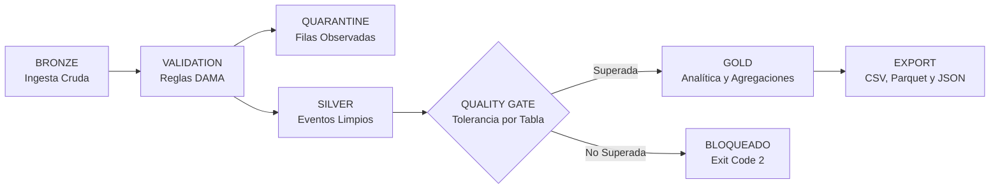

# Amankay — Módulo de Procesamiento de Datos Big Data (`vg-jobs-amankay`)

> **Plataforma GovTech de Big Data para la Gestión y Priorización de Emergencias en el Perú**  
> Versión: `v1.0.0` | Arquitectura: **Medallion Pipeline (Bronze → Silver → Gold) con Cuarentena y Quality Gate**

---

## Integrantes del Equipo

- **Saori Apaza** — *(Responsable de Ingesta y Validación IGP)*
- **Brenda De La O** — *(Responsable de Ingesta y Validación INDECI / SINPAD)*
- **Mathias De La Cruz** — *(Responsable de Ingesta y Validación SENAMHI Hidrológico)*
- **Anghelo Goicochea** — *(Responsable de Ingesta y Validación SENAMHI Meteorológico)*
- **Johan Malazquez** — *(Responsable de Backend API y Streaming de Reportes)*

---

## Objetivo del Proyecto

Centralizar, depurar, normalizar y analizar grandes volúmenes de datos oficiales del Estado Peruano (**IGP**, **SENAMHI**, **INDECI**) y **reportes ciudadanos en tiempo real** para alimentar mapas de calor y dashboards de alerta temprana, permitiendo identificar qué zonas geográficas requieren atención y ayuda humanitaria con mayor urgencia.

### Problema que Resuelve

1. **Dispersión y heterogeneidad de datos**: Las fuentes oficiales emiten información en formatos no estandarizados (coordenadas brutas, fechas mixtas, formatos locales sin validación centralizada).
2. **Falta de visibilidad unificada**: Las entidades de respuesta ante desastres carecen de un consolidado que cruce sismos severos, precipitaciones pluviales críticas, afectación de infraestructura y alertas ciudadanas.
3. **Calidad de datos sin control**: Errores en la ingesta pueden generar falsas alarmas o desviar recursos críticos. El pipeline implementa un **Quality Gate** por tabla y un repositorio de **Cuarentena** para auditoría.

---

## Tecnologías Utilizadas

- **Java 17 LTS**: Lenguaje principal para contratos, workers y backend.
- **Apache Spark 4.1.2 SQL** (Scala 2.13): Motor distribuido de procesamiento de datos en modo `local[*]`.
- **Spring Boot 3.5.x (WebFlux, Validation, Actuator)**: API Reactiva desacoplada del worker Spark.
- **Apache Commons CSV 1.14.1**: Lectura e ingesta robusta de datos crudos.
- **Apache Parquet**: Almacenamiento columnar eficiente y tipado para capas Silver y Gold.
- **Jackson (JSON / YAML)**: Serialización de eventos del ciclo de vida y reportes de calidad.
- **JUnit Jupiter 5.12.x**: Pruebas unitarias y de integración end-to-end.
- **Maven Wrapper (`mvnw`)**: Entorno de compilación portable sin requerir Maven preinstalado.

---

## Arquitectura y Protocolo del Worker

### Pipeline Medallion en 7 Etapas



### Protocolo de Comunicación Desacoplado

El worker Spark corre como **proceso independiente** del backend API:
- **Invocación CLI**:
  ```bash
  java <opciones-jvm> -jar <job>.jar <input-dir> <output-dir> <tolerancia> [spark-ui-seconds]
  ```
- **Códigos de Retorno (Exit Codes)**:
  - `0`: Éxito / Publicado (Capa Gold disponible).
  - `1`: Error no recuperable de infraestructura o configuración.
  - `2`: Bloqueado por la Puerta de Calidad (rechazos superaron la tolerancia por tabla; Gold no se publica).
- **Artefactos en el Directorio de Salida (`output-dir`)**:
  - `events.jsonl`: Trazabilidad secuencial en tiempo real con tiempos y jobs Spark por etapa.
  - `quality.json`: Evaluación dimensional (Completitud, Validez, Unicidad, Integridad, Consistencia) y métricas por tabla.
  - `result.json`: Resumen general de filas recibidas, válidas, rechazadas y tiempo total.
  - `spark.json`: Metadatos de la sesión Spark ejecutada.
  - `quarantine/`: Archivos `rechazados.csv` y `rechazados.parquet` con motivo y fila de origen.
  - `silver/`: Tablas limpias normalizadas por fuente (`igp`, `senamhi`, `indeci`).
  - `gold/`: Tablas analíticas consolidadas y `resumen.json` (solo si el lote fue publicado).

---

## Estructura del Proyecto

```
vg-jobs-amankay/
├── pom.xml                                  # POM raíz agregador y versiones base
├── mvnw, mvnw.cmd, .mvn/                    # Maven Wrapper
├── README.md, CHANGELOG.md                  # Documentación del proyecto
├── .gitignore, .gitattributes               # Control de versiones
├── contracts/                               # Módulo Java puro (Enums, Schemas, Records, Protocolo)
├── spark-worker/                            # Agregador de módulos Spark
│   ├── pom.xml
│   ├── spark-core/                          # Motor genérico del pipeline Medallion
│   ├── spark-official/                      # Dominio de fuentes oficiales (IGP, SENAMHI, INDECI)
│   ├── job-official-batch/                  # Job 1: Lote Oficial (FUNCIONAL con IGP)
│   ├── job-report-stream/                   # Job 2: Streaming de Reportes Ciudadanos (ESQUELETO)
│   └── job-priority/                        # Job 3: Motor de Prioridad y Alertas (ESQUELETO)
├── backend-api/                             # Spring Boot WebFlux API reactiva (ESQUELETO)
├── data/                                    # Muestras de datos en CSV para pruebas locales
│   ├── igp/                                 # Catálogo sísmico del IGP
│   ├── senamhi/                             # Monitoreo meteorológico SENAMHI
│   └── indeci/                              # Emergencias SINPAD INDECI
└── docs/assets/                             # Diagramas y recursos gráficos
```

---

## Descripción de los Tres Pipelines

| Job / Pipeline | Módulo | Clase Principal | Descripción |
| :--- | :--- | :--- | :--- |
| **AMANKAY_OFFICIAL_BATCH** | `job-official-batch` | `pe.edu.vallegrande.amankay.job.official.OfficialBatchJob` | **(Funcional v1.0.0)** Ingesta batch de sismos IGP, validación espacial/temporal, depuración a Silver y agregación Gold por departamentos y tendencias diarias. |
| **AMANKAY_REPORT_STREAM** | `job-report-stream` | `pe.edu.vallegrande.amankay.job.report.ReportStreamJob` | **(Esqueleto v1.0.0)** Ingesta streaming de reportes ciudadanos, deduplicación en ventanas temporales y generación de señales tempranas. |
| **AMANKAY_PRIORITY** | `job-priority` | `pe.edu.vallegrande.amankay.job.priority.PriorityJob` | **(Esqueleto v1.0.0)** Motor de scoring explicable de urgencia (0 a 100) combinando severidad oficial, volumen de reportes y vulnerabilidad territorial. |

---

## Estado del Proyecto

| Componente | Estado | Detalle |
| :--- | :---: | :--- |
| `contracts` | ✅ **Completo** | Contratos de jobs, esquemas oficiales, etapas, reglas DAMA y políticas de prioridad. |
| `spark-core` | ✅ **Completo** | Pipeline Medallion, Quality Gate, publicadores atómicos CSV/Parquet/JSON y CLI launcher. |
| `spark-official` | ✅ **Completo** | Extractores y validadores especializados para IGP, SENAMHI e INDECI, normalizador geoespacial. |
| `job-official-batch` | ✅ **Funcional** | Procesamiento de catálogo IGP, cálculo de resumen departamental, series diarias y pruebas de integración. |
| `job-report-stream` | 🚧 **Esqueleto** | Estructura base compilable con etapas `TODO` documentadas. |
| `job-priority` | 🚧 **Esqueleto** | Estructura base compilable con pasos de scoring `TODO` documentados. |
| `backend-api` | 🚧 **Esqueleto** | Spring Boot 3.5.x WebFlux con dependencias de contracts, actuator y prueba `@SpringBootTest`. |

---

## Compilación y Ejecución

### 1. Compilación de Todos los Módulos

```bash
# En Windows (PowerShell / CMD)
./mvnw.cmd clean package -DskipTests

# En Linux / macOS
./mvnw clean package -DskipTests
```

### 2. Ejecutar las Pruebas Automatizadas

```bash
./mvnw.cmd test
```

### 3. Ejecutar el Job de Catálogo Sísmico IGP (`job-official-batch`)

Para ejecutar directamente el JAR empaquetado del worker Spark sobre Java 17, se deben suministrar las opciones `--add-opens` del JDK requeridas por Spark 4:

```powershell
$SPARK_JVM_OPTS = "--add-opens=java.base/java.lang=ALL-UNNAMED --add-opens=java.base/java.lang.invoke=ALL-UNNAMED --add-opens=java.base/java.lang.reflect=ALL-UNNAMED --add-opens=java.base/java.io=ALL-UNNAMED --add-opens=java.base/java.net=ALL-UNNAMED --add-opens=java.base/java.nio=ALL-UNNAMED --add-opens=java.base/java.util=ALL-UNNAMED --add-opens=java.base/java.util.concurrent=ALL-UNNAMED --add-opens=java.base/java.util.concurrent.atomic=ALL-UNNAMED --add-opens=java.base/sun.nio.ch=ALL-UNNAMED --add-opens=java.base/sun.nio.cs=ALL-UNNAMED --add-opens=java.base/sun.security.action=ALL-UNNAMED --add-opens=java.base/sun.util.calendar=ALL-UNNAMED -Djdk.reflect.useDirectMethodHandle=false -Dio.netty.tryReflectionSetAccessible=true"

# Ejecución del Job (Argumentos: <input-dir> <output-dir> <tolerancia>)
java $SPARK_JVM_OPTS.Split(' ') -jar spark-worker/job-official-batch/target/job-official-batch.jar data/igp output/lote-01 0.05
```

### 4. Salida Esperada en Consola

```text
Lote de Fuentes Oficiales (IGP, SENAMHI, INDECI) · Spark 4.1.2 en local[*] · UI: null
[BRONZE] COMPLETED - igp (25 filas)
[VALIDATION] COMPLETED - 25 eventos válidos, 0 observados
[QUARANTINE] COMPLETED - Sin eventos en cuarentena
[SILVER] COMPLETED - 25 eventos limpios en 1 fuentes
[QUALITY_GATE] COMPLETED - Publicado: los eventos válidos pasan a Gold y las observaciones quedan en cuarentena
[GOLD] COMPLETED - 10 departamentos analizados en resumen sísmico Gold
[EXPORT] COMPLETED - 7 archivos publicados en capa Gold
Resultado: PUBLICADO · recibidas 25 · válidas 25 · rechazadas 0
```
